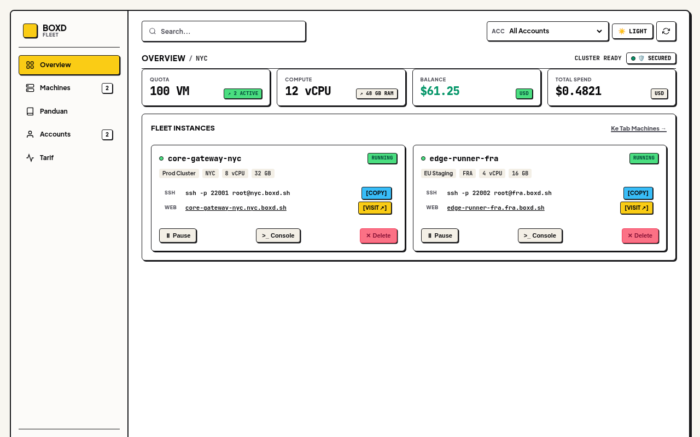
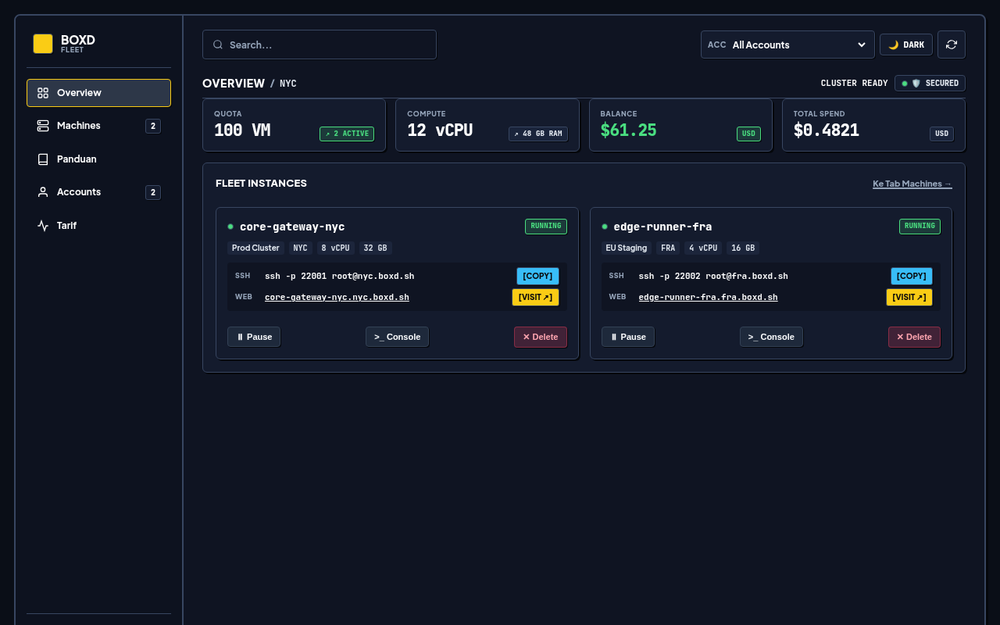
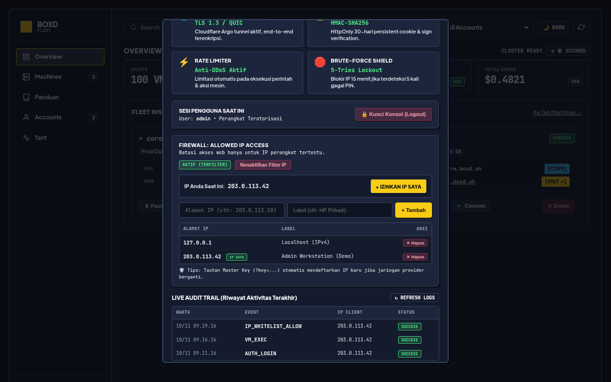

# Boxd Fleet

[](https://nodejs.org)
[](https://expressjs.com)
[](https://sqlite.org)
[](https://workers.cloudflare.com)
[](LICENSE)
[-ff70a6?style=flat-square)](https://instagram.com/rskl411_)

Self-hosted multi-account control plane for [boxd.sh](https://boxd.sh) cloud microVMs. Unifies fleet lifecycle orchestration, terminal command execution, and credit telemetry behind a zero-framework Neo-Brutalism interface, layered with Defense-in-Depth session protection, a toggleable SQLite IP Whitelist firewall, and an optional Cloudflare Worker edge gateway.

---

## Web Preview

### Overview Console (Light Mode)


### Overview Console (Dark Mode)


### Security Center & IP Whitelist Firewall


---

## Untuk Apa Project Ini Berjalan?

Mengelola banyak akun dan instance microVM Boxd secara manual lewat CLI atau dashboard terpisah menimbulkan hambatan operasional harian:

* **Fragmentasi Multi-Akun**: Berpindah-pindah antar beberapa API key (`bxd_...`) hanya untuk mengecek sisa saldo, kuota vCPU/RAM, atau status microVM sangat memakan waktu.
* **Risiko Akses & Penghapusan Tidak Sengaja**: Akses konsol manajemen infrastruktur yang terekspos ke internet publik rentan terhadap brute-force, probing API unauthenticated, atau salah klik hapus instance produksi.
* **Akses Mobile yang Lambat**: Console cloud modern dengan bundle JavaScript besar sering lambat dimuat saat diakses lewat jaringan seluler.

**Boxd Fleet** menyelesaikan masalah tersebut dengan arsitektur self-hosted yang ringan dan terkontrol penuh:

* **Konsolidasi Multi-Akun**: Seluruh akun Boxd beserta status VM, biaya, dan port SSH/Web teragregasi dalam satu tampilan terpadu.
* **Defense-in-Depth Security Gate**: Request API tanpa cookie HMAC-SHA256 atau Master Key ditolak dengan status HTTP 401, dilengkapi rate-limiting bertingkat dan konfirmasi hapus 2 langkah.
* **Dynamic IP Whitelist Firewall**: Membatasi akses dashboard hanya ke IP terdaftar (HTTP 403 untuk IP asing) dengan fitur self-allow dan pemulihan darurat via Master Key saat IP seluler berpindah.

---

## Kelebihan & Kekurangan

| Kategori | Kelebihan (Pros) | Kekurangan (Cons) |
|---|---|---|
| **Arsitektur & Storage** | **Self-Hosted & Local-First**: API key, audit trail, dan daftar allowed IP disimpan lokal di SQLite mode WAL tanpa ketergantungan database cloud eksternal. | **Single-Node State**: Penyimpanan SQLite bersifat lokal pada satu VPS; belum mendukung replikasi multi-region database secara otomatis. |
| **Keamanan Akses** | **Defense-in-Depth Berlapis**: Menggabungkan IP Whitelist, HMAC-SHA256 cookie 30 hari, brute-force lockout, rate limiter per endpoint, dan OWASP security headers. | **Emergency Key Hygiene**: Tautan pemulihan berbasis query key harus dijaga kerahasiaannya walaupun otomatis dihapus dari address bar browser via `history.replaceState`. |
| **Performa & UI** | **Zero-Framework Frontend**: HTML5, CSS3, dan Vanilla JS murni menghasilkan waktu muat cepat dengan dukungan Light/Dark mode serta layout mobile 5-tab simetris. | **Render State Client-Side**: Mengandalkan fetch REST API berkala ke backend VPS untuk pembaruan metrik real-time. |
| **Integrasi & Upstream** | **SDK Resmi Boxd (`@boxd-sh/sdk`)**: Berkomunikasi langsung via gRPC + Protobuf resmi Boxd sehingga kompatibel penuh dengan siklus hidup microVM (`start`, `pause`, `wake`, `exec`). | **Ketergantungan Upstream**: Ketersediaan layanan, kuota region, dan protokol komunikasi tetap bergantung pada API upstream Boxd dan runtime Node.js. |

---

## Technical Architecture

```
                      ┌───────────────────────────────────────┐
                      │       Client Browser / Mobile UI      │
                      │   (Vanilla JS + Light/Dark Neo-UI)    │
                      └───────────────────┬───────────────────┘
                                          │ HTTPS + WSS (custom-domain.example.com)
                                          ▼
┌─────────────────────────────────────────────────────────────────────────┐
│ Cloudflare Worker Edge Gateway (worker/src/worker.js)                   │
│  ├─ Host Rewrite       : Bypass routing loop & forward WebSocket        │
│  └─ Real IP Forwarding : Inject CF-Connecting-IP / X-Real-IP headers    │
└─────────────────────────────────────────┬───────────────────────────────┘
                                          │ Encrypted Tunnel / Origin :7070
                                          ▼
┌─────────────────────────────────────────────────────────────────────────┐
│ Boxd Fleet Server (server.js - Express 5)                               │
│  ├─ Defense-in-Depth   : OWASP headers, per-route rate limit, 2-step del│
│  ├─ IP Firewall Guard  : SQLite allowed_ips + Master Key recovery (?key)│
│  ├─ Session Engine     : HMAC-SHA256 HttpOnly cookie + 5-try lockout    │
│  ├─ Local Persistence  : SQLite WAL (accounts, audit_logs, allowed_ips) │
│  └─ SDK Orchestrator   : @boxd-sh/sdk (gRPC + Protobuf client pool)     │
└─────────────────────────────────────────┬───────────────────────────────┘
                                          │ gRPC over TLS (:9443)
                                          ▼
                      ┌───────────────────────────────────────┐
                      │       Boxd.sh Cloud MicroVMs          │
                      │      (NYC / SFO / FRA / LON / AMS)    │
                      └───────────────────────────────────────┘
```

---

## Kelebihan & Keunggulan

* **Zero-Leak Security Gate**: Endpoint API sensitif otomatis menolak request tanpa autentikasi (`401 Unauthorized`). Mendukung login cepat via parameter `?key=your_access_pin` yang langsung membersihkan riwayat URL browser agar aman dari shoulder surfing.
* **IP Whitelist Firewall dengan Anti-Lockout**: Panel Pusat Keamanan menyediakan saklar ON/OFF firewall IP tanpa restart server, tombol 1-klik untuk mengizinkan IP perangkat saat ini, serta mekanisme auto-register IP baru apabila diakses menggunakan Master Key yang sah.
* **Two-Step Destructive Safety**: Penghapusan microVM dilindungi modal konfirmasi yang mewajibkan pengetikan nama host persis sebelum tombol eksekusi aktif.
* **Built-in Cheatsheet (`Panduan`)**: Tersedia tab panduan terintegrasi berisi perintah SSH port forwarding, CLI Boxd, dan strategi penghematan saldo (`pause` / `hibernate`).

---

## Kekurangan & Batasan Sistem

* **Protokol gRPC Terikat SDK Node.js**: Orkestrasi cluster menggunakan `@boxd-sh/sdk` versi TypeScript/Node.js, sehingga backend memerlukan runtime Node.js v20+ dan dependensi native `better-sqlite3`.
* **Rotasi URL Quick Tunnel**: Jika menggunakan `trycloudflare.com` quick tunnel tanpa named tunnel atau direct origin IP, nilai `BACKEND_HOST` pada Cloudflare Worker perlu diperbarui setiap kali quick tunnel di-restart.
* **Lingkup Eksekusi Terminal**: Fitur `>_ Console` dijalankan secara stateless per perintah melalui endpoint exec Boxd dengan batas rate limit 15 request per menit untuk mencegah spam.

---

## Cara Pakai & Panduan Instalasi

### 1. Prasyarat Sistem
* Node.js v20+ dan npm
* Akun Boxd aktif beserta API key (`bxd_...`)
* Opsional: Akun Cloudflare & Wrangler CLI untuk edge gateway

### 2. Setup Backend Console
```bash
# Clone repository
git clone https://github.com/rndsa/boxd-fleet.git
cd boxd-fleet

# Install dependensi
npm install

# Salin dan isi konfigurasi environment
cp .env.example .env
```

### 3. Konfigurasi Environment (`.env`)

| Variabel | Deskripsi | Wajib? | Default |
|---|---|---|---|
| `PORT` | Port HTTP backend server | Opsional | `7070` |
| `ACCESS_PIN` | Master PIN login konsol dan URL `?key=` | Ya | `change-me-pin-2026` |
| `SESSION_SECRET` | Secret key signing HMAC-SHA256 cookie | Ya | Random ephemeral hex |
| `VPS_HOST_IP` | IP VPS yang otomatis di-seed ke whitelist | Opsional | Kosong |

### 4. Menjalankan Aplikasi
```bash
# Jalankan backend server
npm start

# Akses lokal di browser
# http://127.0.0.1:7070
```

### 5. Deploy Cloudflare Worker Edge Gateway (Opsional)
1. Masuk ke folder worker dan salin template konfigurasi:
   ```bash
   cd worker
   cp wrangler.toml.example wrangler.toml
   ```
2. Isi `account_id`, custom domain route (misalnya `console.example.com/*`), dan variabel `BACKEND_HOST` di `wrangler.toml` menuju domain tunnel atau origin HTTPS backend Anda.
3. Login dan deploy ke Cloudflare Edge:
   ```bash
   npx wrangler login
   npx wrangler deploy
   ```

---

## Penggunaan via API & CLI

Contoh memeriksa status autentikasi dan daftar microVM menggunakan session cookie:

```bash
# Autentikasi menggunakan Master Key & simpan cookie session
curl -s -c cookies.txt "http://127.0.0.1:7070/api/auth/status?key=your_access_pin"

# Ambil daftar seluruh microVM lintas akun
curl -s -b cookies.txt "http://127.0.0.1:7070/api/machines?accountId=all"
```

---

## Production Deployment (PM2 & systemd)

### Menggunakan PM2
```bash
pm2 start server.js --name boxd-fleet
pm2 save
```

### Menggunakan systemd
```ini
[Unit]
Description=Boxd Fleet Management Console
After=network.target

[Service]
Type=simple
User=root
WorkingDirectory=/root/boxd-manager
ExecStart=/usr/bin/node server.js
Restart=always
EnvironmentFile=/root/boxd-manager/.env

[Install]
WantedBy=multi-user.target
```

---

## Verification & Tests

Jalankan suite smoke test (menguji modul HMAC auth, masker API key SQLite, proteksi `401 Unauthorized`, validasi PIN, dan serving SPA):

```bash
npm test
```

---

## License & Author

* **License**: [MIT](LICENSE) — Copyright (c) 2026 ren
* **Author**: [ren](https://instagram.com/rskl411_) • GitHub: [@rndsa](https://github.com/rndsa)
